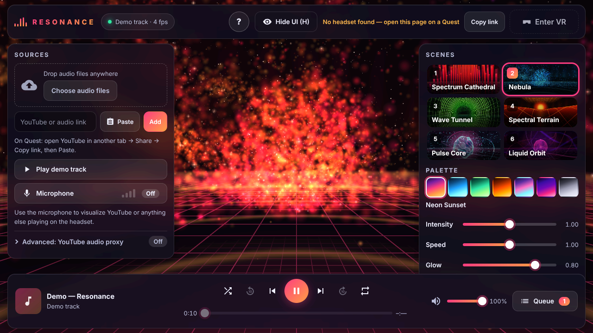

# Resonance VR

[English](README.md)

**Meta Quest 2**(およびWebXR対応のブラウザ)向けの、没入型ミュージックビジュアライザー兼プレーヤーです。three.js + WebXR + TypeScript で作られています。
バックエンドは不要で、静的サイトとして動作します。



| | |
|---|---|
| 🎧 **音源** | ローカルファイル · 音声ファイルの直接URL · **YouTube**(公式プレーヤー + マイクによるループバック解析、または、より正確な解析のための任意のセルフホスト用プロキシ) · マイク · 内蔵のデモ曲(合成音) |
| 🌌 **シーン** | Spectrum Cathedral · Nebula · Wave Tunnel · Spectral Terrain · Pulse Core · Liquid Orbit。さらにオーロラの空、7種類のパレット、Intensity(強度) / Speed(速度) / Glow(輝き)の調整、自動切り替え |
| 🎛 **VR UI** | 空間に浮かぶパネル(レーザーポインター + トリガー、ハンドトラッキングのピンチ操作)、サムスティックのショートカット、つかんで移動、自動非表示、位置のリセット、ミニHUD |
| 🖥 **2D UI** | デスクトップやQuestの2Dブラウザで設定するためのガラス調オーバーレイ:ドラッグ&ドロップ、リンクの貼り付け、マイク、プロキシのテスト、シーン一覧、キーボードショートカット |
| ⚡ **Quest 2に最適化** | インスタンス描画 / GPU側のジオメトリ、1シーンあたり描画コール8回以下、ポストプロセスなし、実行中の画質切り替え、固定フォビエーション |

ドキュメント: [`docs/QUEST.md`](docs/QUEST.md)(ヘッドセットでの使い方) · [`docs/ARCHITECTURE.md`](docs/ARCHITECTURE.md)(設計と仕様) ·
[`docs/QUALITY_BAR.md`](docs/QUALITY_BAR.md)(レビュー基準) · [`server/README.md`](server/README.md)(任意のYouTube音声プロキシ)

## クイックスタート
```bash
npm install
npm run dev        # http://localhost:5173 — desktop preview with mouse look; press 1-6 for scenes, Space to play the demo
npm run build      # static site in dist/
```
ヘッドセットで使うには、ページを **HTTPS** で配信する必要があります(GitHub Pagesならそのまま使えます。ローカルで試す場合は
`cloudflared tunnel --url http://localhost:5173` のようなトンネルを使ってください)。

### GitHub Pagesへのデプロイ
`.github/workflows/deploy.yml` のワークフローが、`main` へのプッシュのたびに `dist/` をビルドして公開します
(最初に一度だけ *Settings → Pages → Source: GitHub Actions* を有効にしてください)。公開後のURLは `https://<user>.github.io/<repo>/` です。

## Quest 2での使い方
1. Questのブラウザでこのサイトを開きます。音楽を追加します。ファイルを選ぶ、YouTubeのリンク/プレイリストまたは音声ファイルの直接URLを貼り付ける、あるいはマイクをオンにします。
2. **Enter VR** を押します。操作パネルが目の前に浮かぶので、ポインターを向けてトリガーを引いてください。
3. サムスティックの左右でシーン切り替え、上下で音量調整、A/Xボタンで再生/一時停止、B/Yボタンでメニューを非表示にします。グリップを握ったままにするとパネルを動かせます。

**YouTubeについて:** Webページは、YouTubeのプレーヤーから音声を直接読み取ることが(オリジン間の制限により)できません。そのため本アプリは、公式プレーヤーで動画を再生し、
エコーキャンセルをオフにしたヘッドセットのマイクで音を拾って解析します。より正確に解析したい場合は、同じLAN内で任意のプロキシを動かし、
そのURLを *Sources → Advanced* に入力してください。

## テスト
```bash
npm run typecheck          # TypeScript
npm test                   # build + headless Chromium: screenshots of every scene, an emulated Quest 2 XR session
                           # (IWER) with controller input, and a 60 Hz audio-feature sanity check → tests/out/
```
`npm test` は、ビルド後にヘッドレスChromiumで全シーンのスクリーンショット撮影、コントローラー入力つきのQuest 2 XRセッション(IWER)のエミュレーション、60 Hzの音声特徴量の動作確認を行い、結果を `tests/out/` に出力します。

## キーボード操作(デスクトップ)
Space 再生/一時停止 · ←/→ 10秒シーク · Shift+←/→ 曲の切り替え · ↑/↓ 音量 · N/P シーン切り替え · 1-6 シーン選択 · C パレット切り替え · A 自動切り替え · M VRメニューのプレビュー · H UIを隠す · ? ヘルプ
